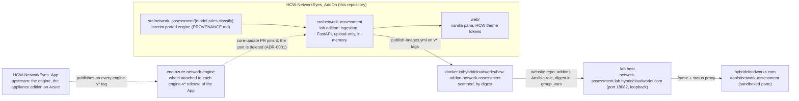

# Hybrid Cloud Works Network Assessment

**The lab edition of the Network Assessment: evaluate an Azure Resource Graph export of your network resources against typed network, resilience and cost rules, in memory, with no cloud connectivity by design.**

[](https://github.com/saulpatinojr/HCW-NetworkEyes_AddOn/actions/workflows/ci.yml)
[](https://github.com/saulpatinojr/HCW-NetworkEyes_AddOn/actions/workflows/security.yml)
[](https://github.com/saulpatinojr/HCW-NetworkEyes_AddOn/actions/workflows/publish-images.yml)
[](https://github.com/saulpatinojr/HCW-NetworkEyes_AddOn/actions/workflows/core-update.yml)
[](.python-version)
[](docs/deployment/lab-host.md)
[](LICENSE)

Upload the JSON that `az graph query` prints for `microsoft.network/*`, or the CSV that Resource Graph Explorer
downloads, and get the topology pattern (hub-spoke, vWAN, mesh, isolated), a findings table with the observed fact and
the field it came from for every finding, the rules the export cannot answer, and a report bundle. The lab **never
connects to a cloud, never asks for credentials and keeps nothing**: an upload is processed in memory, returned only to
the browser session that holds its owner token, and expires after two hours or when deleted. Every finding states what
the export carried, never what is assumed (the observed-state enforcer gates every fact), and the rules that need
metrics, diagnostic settings, BGP state or cost are reported as `unknowns`, in data, not only in prose. It is not for
production.

**Where to try it.** The pane will appear at [hybridcloudworks.com/tools/network-assessment](https://hybridcloudworks.com/tools/network-assessment)
once the first image is published; until then, run it on your own machine with the Quick start below and open
`http://127.0.0.1:8080`. There is no account and nothing to install in Azure: you export, you upload, you read.

> **Status:** lab edition, not production. Limitations are recorded in [`VALIDATION.md`](VALIDATION.md). The engine is
> an interim port of the App's, with provenance ([`PROVENANCE.md`](PROVENANCE.md)); every rule's reference link and
> every compliance-framework reference is marked `[VERIFY]` until the owner confirms it; the MIT relicensing of the
> ported code is `[REVIEW REQUIRED]` ([`NOTICE`](NOTICE)).

## How the pieces relate



The engine is ported **here** from the App (`HCW-NetworkEyes_App`) at `5d3b914` so the lab can ship now
([`docs/adr/ADR-0001-interim-ported-engine.md`](docs/adr/ADR-0001-interim-ported-engine.md)). When the App publishes
`cna-azure-network-engine`, `.github/workflows/core-update.yml` pins the wheel, this repository deletes the ported
copy, and later releases arrive as compatible / needs-adaptation pull requests. Nothing here can reach Azure:
`tests/security/test_edition_boundary.py` fails the build if anything could, and `publish-images.yml` proves
`import azure` fails inside the built image.

## Connecting the website

| Concern | Where it is defined |
|---|---|
| The catalogue row (`id: network-assessment`), the `/tools/network-assessment` route, the status proxy projection, the pane protocol (`hcw-addon` messages, four states), the sandbox and the `downloads` capability request, the environment table, the copy rules | [`docs/website-integration/integration-guide.md`](docs/website-integration/integration-guide.md) |
| The one site route, pre-render and route-inventory entry | [`docs/website-integration/routes.md`](docs/website-integration/routes.md) |
| The API the pane calls (`/api/health`, `/api/config`, `/api/rules`, `/api/sample.*`, `/api/assessments`, bundle and file downloads, delete) | [`docs/api/openapi.yaml`](docs/api/openapi.yaml) |
| Hosting by the website's `addons` Ansible role: image by digest, env table, port 18082 on loopback, container hardening, the human-verification widget and vault key, Docker Hub publishing | [`docs/deployment/lab-host.md`](docs/deployment/lab-host.md) |
| Threats and controls (in-memory data, owner tokens, limits, fail-closed verification, edition boundary, no path to the host's identity endpoint) | [`docs/security/threat-model.md`](docs/security/threat-model.md) |

Only public configuration crosses the boundary: the origin and the verification *site key* are public; the verification
*secret* lives in the lab host's vault (`vault_addon_network_assessment_turnstile_secret`), never in the site, Git or
Terraform state.

## Quick start

Requires Python 3.14.6 or newer and [`uv`](https://docs.astral.sh/uv/) 0.11.32 or newer.

```bash
uv python pin 3.14.6 && uv sync
uv run pytest -q --cov=src                        # unit, contract, security, manifest; coverage gate 85
NA_ALLOW_NO_TURNSTILE=1 PORT=8080 uv run python -m network_assessment   # http://127.0.0.1:8080
curl -s http://127.0.0.1:8080/api/health
curl -s -X POST http://127.0.0.1:8080/api/assessments -H 'content-type: application/json' --data-binary @samples/sample-resource-graph.json
```

PowerShell:

```powershell
uv python pin 3.14.6; uv sync
uv run pytest -q --cov=src
$env:NA_ALLOW_NO_TURNSTILE = "1"; $env:PORT = "8080"; uv run python -m network_assessment
Invoke-RestMethod http://127.0.0.1:8080/api/health
Invoke-RestMethod -Method Post -Uri http://127.0.0.1:8080/api/assessments -ContentType application/json -InFile samples/sample-resource-graph.json
```

`NA_ALLOW_NO_TURNSTILE=1` is for local development and e2e only: without it and without `TURNSTILE_SECRET`, uploads
answer `503 turnstile_not_configured` (fail closed). Browser suite: `make e2e` (Playwright chromium). Container:
`docker compose up` (hardened, loopback-only). Export commands for a real estate: [`docs/demo/user-guide.md`](docs/demo/user-guide.md).

## Repository map

| Path | What |
|---|---|
| `src/network_assessment/model` | The lab topology model (`TOPOLOGY_MODEL_VERSION = "lab-1.0.0"`), the findings model and the observed-state enforcer, ported |
| `src/network_assessment/rules` | `registry.py` (`@rule`, `RULES`, `RULES_VERSION = "2026.10.0"`, `evaluate()`), `azure_net.py` (AZ-NET-001..033), `azure_bcdr.py` (001..007), `azure_cost.py` (001, 004; 002/003/005 live-only), `frameworks.py` (mappings as data), `taxonomy.py` |
| `src/network_assessment/classify` | The topology classifier, ported |
| `src/network_assessment/ingestion` | `parse.py` (JSON array or `az graph query` envelope, Resource Graph Explorer CSV, portal CSV with the warning), `arg_row.py`, `normalize.py` (the ~20 `microsoft.network/*` types onto the model) |
| `src/network_assessment/report` | Summary document, `report.md`, the bundle |
| `src/network_assessment` | The lab application: `config.py` (`NA_*`), `edition.py` (import-time guard), `store.py`, `security/` (verification with hostname binding, headers, CORS, limits, rate limit, content-free logging), `routes/`, `app.py`, `assess.py`, `__main__.py` |
| `web/` | The pane: `index.html`, `app.js`, `styles.css`, `theme.css` (HCW tokens copied with provenance) |
| `samples/` | 48 fictional rows (subscriptions `…0001` hub and `…0002` spokes, `hcw-sample-*`, `eastus2`) in three export shapes, designed so every portable rule fires; results pinned in a test |
| `tests/` | `unit` (incl. ported rule tests, sample expectations, registry invariants), `contract` (OpenAPI two-way), `security` (edition boundary, no secrets, content-free logs), `end_to_end` (manifest, provenance headers), `e2e` (Playwright, with a host page that applies the site's sandbox) |
| [`docs/`](docs/README.md) | Website integration, API, lab-host deployment, appliance pointer, runbook, threat model, user guide, bundle, generated rule catalog, ADRs |
| [`infrastructure/`](infrastructure/README.md) | Dockerfile (two stages, hash-pinned, uid 10001, `HEALTHCHECK`), `versions.env`, `coder/template/main.tf` (`na-guided-lab` on `hcw-lab`) |
| `scripts/` | `rules-doc.py` (catalog generation and drift check), `package-repository.{sh,ps1}` |

## Releases and artifacts

A `v*` tag builds the image, proves the edition boundary inside it, scans it (Trivy, HIGH/CRITICAL, fixed only), pushes
`docker.io/hybridcloudworks/hcw-addon-network-assessment:<version>` with provenance and SBOM, attests it, and prints the
digest in the run summary. The website pins that digest in its lab-host `group_vars`; the digest is the only coupling.
The push is skipped until the owner enables the Docker OIDC connection (`docs/deployment/lab-host.md`).

## What the export cannot show

Utilisation and saturation (gateways, firewalls, load balancers, circuits); diagnostic settings; attacks in progress;
BGP peer state and learned routes; effective routes and effective NSG rules per network interface; private endpoint DNS
resolution; Defender assessments and cost; flow logs when the export has no `networkwatchers/flowlogs` rows; resources
outside `microsoft.network/`, resources the exporting identity could not read, and subscriptions not in the export.
Each maps to a registered rule that answers `unknown` with that reason, to the "What this cannot tell you" panel in the
pane and to `report.md`.

## Contributing, security, license

[`CONTRIBUTING.md`](CONTRIBUTING.md) · [`SECURITY.md`](SECURITY.md) · [`CODE_OF_CONDUCT.md`](CODE_OF_CONDUCT.md) ·
MIT ([`LICENSE`](LICENSE), [`NOTICE`](NOTICE), [`PROVENANCE.md`](PROVENANCE.md)). Coding-agent guidance:
[`AGENTS.md`](AGENTS.md), [`CLAUDE.md`](CLAUDE.md).
